# Enveda CASMI 2026 — Molecule ID from MS/MS spectra

**Release v0.3** · Kaggle competition *Enveda CASMI 2026 – Molecule ID From Mass Spectra* · metric **MRR@25**

Given an LC-MS/MS spectrum of a natural product, predict its 2D structure (SMILES), including molecules that never appear in the training data. v0.2 was an end-to-end, leakage-aware solution: spectrum → fingerprint deep MLP → mass-window candidate filter → ranking over a train + COCONUT library with a PubChem popularity prior (0.146). **v0.3 swaps the ranking model for the public pretrained FPNet and reaches MRR@25 = 0.229 on the hidden test (best so far).**

> **Read this first (honest status).** Leaderboard history: **0.076** (train-only library) → **0.128** (+ COCONUT) → **0.146** (+ popularity prior) → 0.148 (mass windows ×2, a calibration probe: no effect) → **0.229** (public FPNet replaces our MLP as the ranker). A PubChem mass-window channel was neutral (0.142 vs 0.140 at the same weight). A single score has a standard error of about 0.014, so differences below ~0.01 are noise; the +0.081 of FPNet is about six standard errors. Public pipelines reach 0.35–0.46 on essentially the same candidate pool, so a gap of 0.12–0.23 remains and **the ranker/engine is still the lever**. A further submission (average of three FPNet checkpoints) was still in Kaggle's scoring queue when this release was written; it is not in the tables. The local benchmark numbers in the v0.1–v0.3b sections measure ranking quality of *our own* MLP when the true molecule is in the candidate pool; they are optimistic for novel molecules, and **FPNet cannot be validated locally** (it was trained on every molecule we could validate on); see [Limitations](#limitations).
>
> **The walkthroughs with every figure and table are the report notebooks [`notebooks/casmi_v0_3.ipynb`](notebooks/casmi_v0_3.ipynb) (this release: windows probe and FPNet) and [`notebooks/casmi_v0_2.ipynb`](notebooks/casmi_v0_2.ipynb) (data, method, experiments up to 0.146)** (already executed; neither needs competition data).

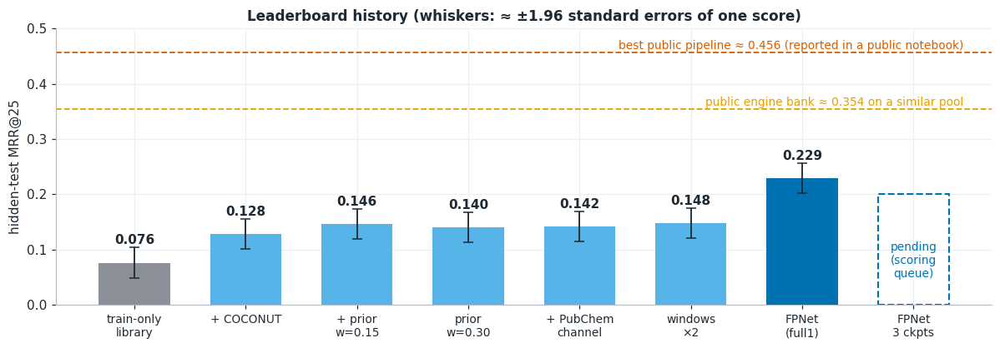

---

## Contents
1. [Problem and metric](#problem-and-metric)
2. [Approach](#approach)
3. [Results at a glance](#results-at-a-glance)
4. [The v0.1 baseline in detail](#the-v01-baseline-in-detail)
5. [Improvements after v0.1](#improvements-after-v01)
6. [Limitations](#limitations)
7. [Repository layout](#repository-layout)
8. [Reproducing](#reproducing)
9. [Data, rules and licences](#data-rules-and-licences)
10. [Roadmap](#roadmap)

---

## Problem and metric
- **Input:** a tandem mass spectrum (list of fragment m/z + intensity), the precursor m/z and the adduct (e.g. `[M+H]+`), plus acquisition metadata. No formula or structure is given. Several spectra (different collision energies/adducts/polarities) can belong to one `molecule_id`.
- **Output:** up to 25 SMILES per `molecule_id`, best first, joined by `;`.
- **Metric:** MRR@25. Rank 1 scores 1.0, rank 2 scores 0.5, … rank 25 scores 0.04, a miss scores 0. A hit means the InChIKey14 (connectivity block) matches after RDKit tautomer canonicalisation (RDKit 2026.03.3); stereochemistry and tautomers are not penalised.
- **Training data:** ~2.54M spectra from open libraries and Enveda-180 (timsTOF); after cleaning, 1.73M spectra and 253,832 unique molecules.

## Approach
```
spectrum ──► sparse features ──► model ──► predicted Morgan fingerprint (1,024 bits)
                                                      │
precursor m/z + adduct ──► neutral mass ──► mass window ──► candidate molecules ──► rank by cosine ──► top 25
```
1. **Cleaning.** Keep known adducts, precursor 50–1500 m/z, recorded |error| ≤ 20 ppm; collapse array-valued collision energies; drop dimers.
2. **Neutral mass** = (precursor m/z − adduct shift) / n. The mass window is a free, strong filter on candidates.
3. **Features** (v0.1: 1 Da bins; final: fragment block + neutral-loss block, each in nominal-mass × mass-defect sub-bins, ~32k sparse columns).
4. **Targets:** Morgan fingerprint, radius 2, 1,024 bits. **Model:** Ridge (v0.1) → deep residual MLP (v0.3b, 633k training spectra).
5. **Candidates:** a library of 684,568 molecules (252,418 training molecules + 432,150 COCONUT natural products, v0.4) filtered to those whose exact mass falls in the per-adduct, instrument-offset-corrected window (centred, half-width max(3 ppm, 3.5σ)).
6. **Ranking (v0.2):** `z(cosine(predicted, candidate fingerprint) within the window) + 0.15 · pop`, where `pop = ln(1+substance records) + ln(1+PubMed articles)` is a public PubChem documentation prior (v0.4b). For a test molecule with several spectra, the predicted fingerprints are averaged and the mass windows intersected (**molecule-level pooling**, +0.03 to +0.06 MRR).
7. **Ranking (v0.3, best):** the same library, windows, pooling and prior, but the spectrum → fingerprint model is the public **FPNet** (transformer, 10,226-bit fingerprint, trained for ranking) and a candidate scores `f · logits` with precomputed candidate fingerprints; our MLP is only used for the windows (and an optional blend, off). See [v0.3](#v03--replace-the-ranker-with-a-public-pretrained-model-p10).

**Validation that avoids the usual traps.** 80/20 split grouped by Murcko scaffold computed with stereo removed; every acyclic molecule is its own group; any validation molecule whose canonical key is in train is hard-removed and the overlap is `assert`ed to be zero. Tautomer canonicalisation is cached. Seeds are fixed (42). Scores are reported on two slices: the **enveda-180 validation slice** (test-like acquisition and mass window; the primary slice) and the **mixed validation set** (2,000 spectra from all sources), both against a **230k-molecule candidate pool** (true molecules + 200k decoys) because a 30k pool badly flatters the score.

## Results at a glance
MRR@25 on the 230k-molecule benchmark pool. "Random" = candidates in the mass window ranked in random order (it measures what the mass filter alone achieves; `model − random` is what the model adds).

| Version | Single change | enveda-180 val | mixed val |
|---|---|---|---|
| v0.1 | Ridge on 1 Da bins, ±10 ppm window | 0.1705 | 0.4125 |
| v0.1b | Mass window centred on per-adduct offset | 0.2611 | 0.4125\* |
| v0.2a | + neutral-loss feature block | 0.2767 | 0.4469 |
| v0.2b | 0.1 Da bins (sparse) | 0.3214 | 0.4839 |
| v0.2c | Mass-defect-aware sub-bins (0.02 Da) | 0.4084 | 0.5425 |
| v0.3 | Ridge → MLP at 62k spectra (**not adopted**, negative result) | 0.2832 | 0.4542 |
| **v0.3b** | **10× more data (633k spectra) + deep residual MLP** | **0.6706** | **0.6557** |
| (reference) | random order in the mass window | 0.1835 | 0.3111 |

\*the mixed slice uses the original uncentred 10 ppm window. Pooling a molecule's spectra into one query adds a further +0.03 to +0.06 MRR (deep MLP, enveda-180 molecules: 0.6695 → 0.7314).

Each row changes one thing; the full record with confidence intervals, checks and caveats is in [`docs/EXPERIMENT_LOG.md`](docs/EXPERIMENT_LOG.md). Per-experiment tables are in [`results/`](results/).

**Leaderboard (hidden test, MRR@25).** The number that matters for the competition; far below the local benchmark because most hidden molecules are not in the candidate library (see [Limitations](#limitations)).

| Submission | Candidate library | Ranking | Leaderboard |
|---|---|---|---:|
| v0.3b deep MLP, train-only library | 252,418 training molecules | cosine | 0.076 |
| v0.4a + COCONUT | + 432,150 = 684,568 | cosine | 0.128 |
| **v0.4b + popularity prior (w = 0.15)** | same | z(cosine) + 0.15·pop | **0.146** |
| prior weight 0.30 | same | z(cosine) + 0.30·pop | 0.140 |
| v0.4c + PubChem mass-window channel (library bonus 2, w = 0.30) | + PubChem structures in each window | z(cosine) + 0.30·pop (+ bonus) | 0.142 |
| v0.5a mass windows ×2 (calibration probe), w = 0.15 | same | z(cosine) + 0.15·pop | 0.148 |
| **v0.5b public FPNet (`fpnet_full1`) replaces our MLP, w = 0.15** | same | z(f·logits) + 0.15·pop | **0.229** |
| v0.5c average of three FPNet checkpoints | same | same | *pending (scoring queue)* |

An early Ridge baseline notebook run on a tiny sample scored 0.0 (uninformative).

---

## The v0.1 baseline in detail
The first end-to-end pipeline: 1 Da bins + Ridge → Morgan-1024 fingerprints → rank candidates in a 10 ppm window. Code: [`notebooks/enveda-casmi26-baseline.ipynb`](notebooks/enveda-casmi26-baseline.ipynb) (cells 0–49), condensed in [`reference/v0_1_pipeline.py`](reference/v0_1_pipeline.py). Working set: 76,248 spectra, 29,964 molecules (≤5,000 molecules per source, ≤3 spectra each); split 61,701 train / 14,547 validation rows.

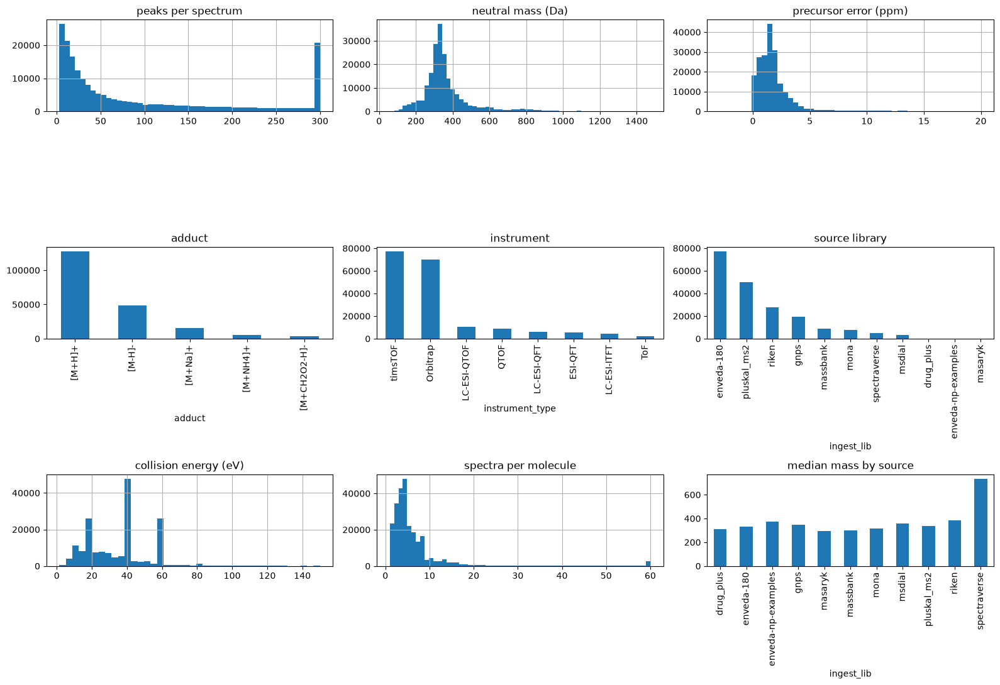
*Training data after cleaning (200k sample): peaks per spectrum, neutral mass, precursor error, adduct, instrument, source, collision energy, spectra per molecule.*

| Method | MRR@25 |
|---|---|
| A. Frequency floor (always the 25 most common training molecules) | 0.0000 |
| B. Cosine spectral-library match (train-only library) | 0.0000 |
| C. Predict fingerprint, rank train-only library | 0.0000 |
| D. C + 10 ppm mass filter (train-only library) | 0.0000 |
| E1. Oracle library (val molecules added, ~30k pool), no mass filter | 0.0050 (≈40× chance) |
| E2. Oracle library + 10 ppm filter | 0.6752 |
| E3. Oracle + filter, **random** order | 0.5844 (model adds only ≈0.09) |

**What this tells us.** (i) Any method restricted to a train-only library scores exactly 0 on unseen molecules — the candidate pool is the biggest lever. (ii) Inside a 10 ppm window the pool is small (median 3 candidates at 30k), so even random order scores 0.58; E2 is misleadingly high. (iii) 1.65% of true molecules fall outside the window (mostly riken/`[M+Na]+`).

**Scaling benchmark.** Adding up to 200k real decoy molecules to the pool (true molecule always present, 10 ppm) is the honest test, and the one used for all later versions:

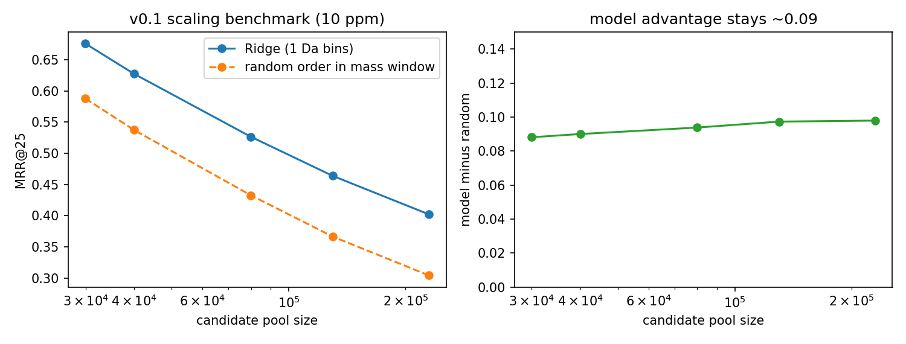

| Pool | Cand./query (mean) | Model | Random | Model − random |
|---|---|---|---|---|
| 29,964 | 4.7 | 0.6759 | 0.5878 | 0.088 |
| 39,964 | 6.4 | 0.6275 | 0.5375 | 0.090 |
| 79,964 | 13.7 | 0.5265 | 0.4327 | 0.094 |
| 129,964 | 22.7 | 0.4638 | 0.3665 | 0.097 |
| 229,964 | 40.6 | 0.4021 | 0.3042 | 0.098 |

Source: [`results/v0.1_scaling_benchmark.csv`](results/v0.1_scaling_benchmark.csv). The v0.1 evaluation sample was not seeded, so re-runs differ by ~0.01 (the notebook's inline plot and `docs/EXPERIMENT_LOG.md` quote 0.396–0.423 at 230k); the table and figure here use the saved CSV. The model's advantage over random is flat (~0.09): the Ridge ranker is weak, and at realistic pool sizes mass alone leaves many isomers.

---

## Improvements after v0.1
Every step was judged on the 230k pool with both slices. Paired molecule-clustered bootstrap CIs are in [`results/`](results/) (`*_bootstrap.csv`).

### Understand the data (EDA)
Figures: [`reports/p2_*`](reports/). Findings that shaped the model:
- Spectra of one molecule differ strongly by collision energy (median cosine 20 vs 60 eV = 0.33; chance 0.03), so a molecule should be scored from *all* its spectra together.
- Enveda-180 matches the target acquisition (timsTOF, 20/40/60 eV), but its chemistry is combinatorial and N-rich (100% contain N, 0% acyclic); natural-product sources look different.
- 21% of test-like spectra exceed the v0.1 500-peak cap, so dense spectra should be capped to top-K peaks rather than dropped.

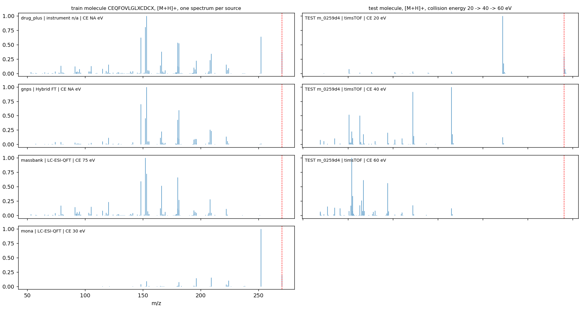
*One molecule measured in different libraries/instruments/collision energies (left) and one spectrum at 20 → 40 → 60 eV (right).*

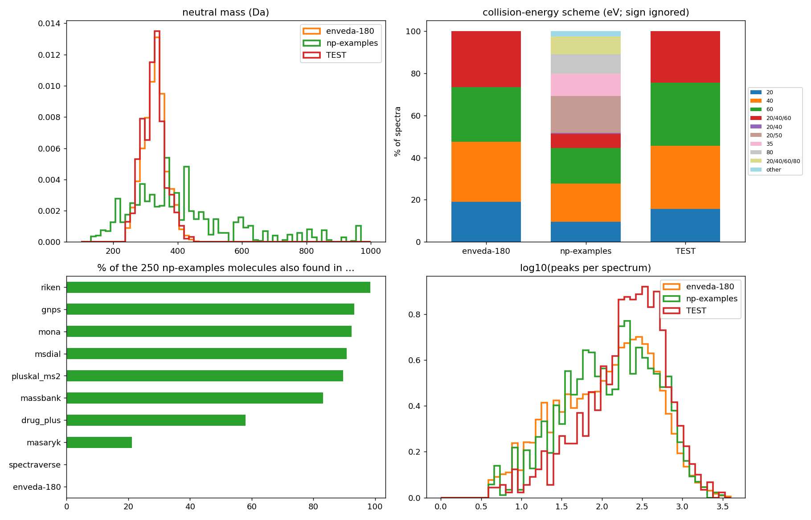
*Enveda natural-product examples vs enveda-180 vs the test-like file: mass range, collision-energy scheme, overlap with other sources, peak counts.*

Other EDA figures: [spectrum agreement](reports/p2_1b_spectrum_agreement.png), [distributions by source](reports/p2_2_distributions_by_source.png), [adduct/polarity/instrument mix](reports/p2_3_adduct_polarity_instrument_mix.png), [molecule properties](reports/p2_5_molecule_properties.png) ([table](reports/p2_5_molecule_properties.csv)).

### v0.1b — Mass-window policy (P3)
`precursor_error_ppm` in the data is unsigned and hides a systematic instrument offset. Recomputing signed errors from the molecular formula gives a per-adduct offset (e.g. `[M+H]+` +2.22 ppm, σ 0.87), so the window is centred on it ([`results/mass_policy_v1.csv`](results/mass_policy_v1.csv), [`src/mass_window.py`](src/mass_window.py)).

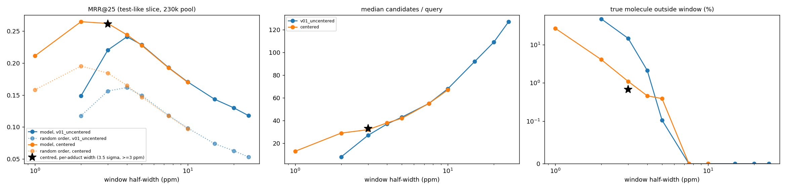
*Test-like slice: MRR, median candidates and miss rate versus window half-width. The star is the adopted policy.*

Test-like slice: 0.1705 → **0.2611** (median candidates 68 → 33, true molecule outside window 0.67%). Most of the gain is fewer candidates, not a better model. Supporting figures: [mass bias](reports/p3_1_mass_bias.png), [miss vs tolerance](reports/p3_2_miss_vs_tolerance.png), [candidates vs tolerance](reports/p3_3_candidates_vs_tolerance.png).

### v0.2a–c — Better spectrum features (P4)
| Step | Idea | enveda-180 | mixed |
|---|---|---|---|
| v0.2a | Add a neutral-loss block (precursor m/z − fragment m/z); shared losses (H₂O, CO…) generalise across molecules | 0.2767 (+0.0156) | 0.4469 |
| v0.2b | 0.1 Da bins instead of 1 Da (keeps part of the mass defect = elemental composition) | 0.3214 (+0.0447) | 0.4839 |
| v0.2c | Spend columns where intense fragments live: 15 × 0.02 Da sub-bins on defect [−0.05, +0.25) per Da | **0.4084** (+0.0870) | **0.5425** |

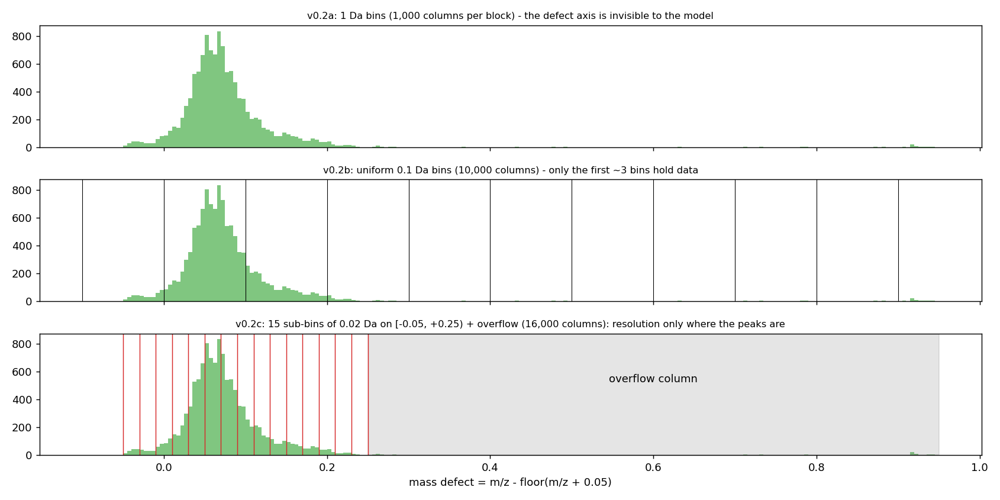
*The three binning schemes on the mass-defect axis.*

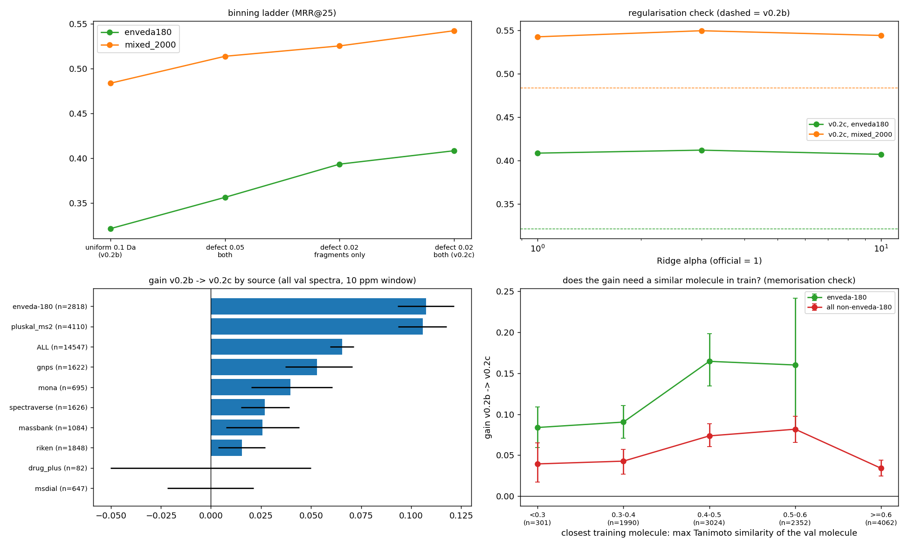
*v0.2c: binning ladder, Ridge-α robustness, gain by source, and the memorisation check (gain by similarity of the validation molecule to its nearest training molecule).*

The gain is partly tied to similar molecules being in train (enveda-180 +0.16 at Tanimoto ≥ 0.5 vs +0.084 at 0.3–0.4; non-enveda-180 +0.039 below 0.3), so natural-product test molecules should see the smaller end. Further figures: [neutral-loss intuition](reports/p4a_1_neutral_loss_intuition.png), [P4a results](reports/p4a_2_results.png), [resolution intuition](reports/p4b_1_resolution_intuition.png), [P4b results](reports/p4b_2_results.png).

### v0.3 — Ridge → MLP, a negative result (P5)
An MLP (BCE on fingerprint bits, scaffold-grouped early stopping) lost to Ridge in all four configurations at 62k training spectra (enveda-180 0.2832 vs 0.4084). A Ridge/MLP blend and a Bernoulli log-likelihood ranking rule did not rescue it.

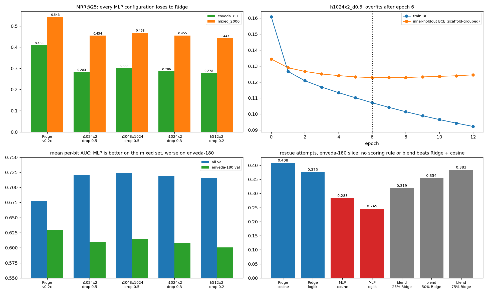

### v0.3b — Data scale and depth (P5b)
The v0.3 verdict was a small-data artefact. With nested training tiers up to 633,198 spectra (every cleaned molecule outside validation, ≤3 spectra each) the MLP overtakes Ridge between 140k and 633k spectra, and a deep residual MLP (Linear 1024 → 4 pre-norm residual blocks → 1,024 sigmoid outputs) reaches **0.6706 / 0.6557**, +0.1005 / +0.0685 over Ridge on the same data.

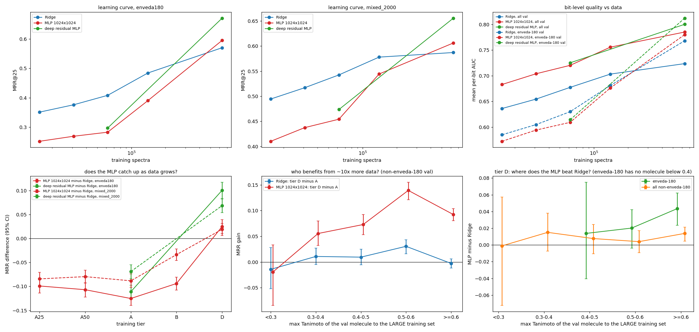
*Learning curves (Ridge vs MLP vs deep MLP), bit-level AUC, MLP-minus-Ridge by tier and by similarity to the large training set.*

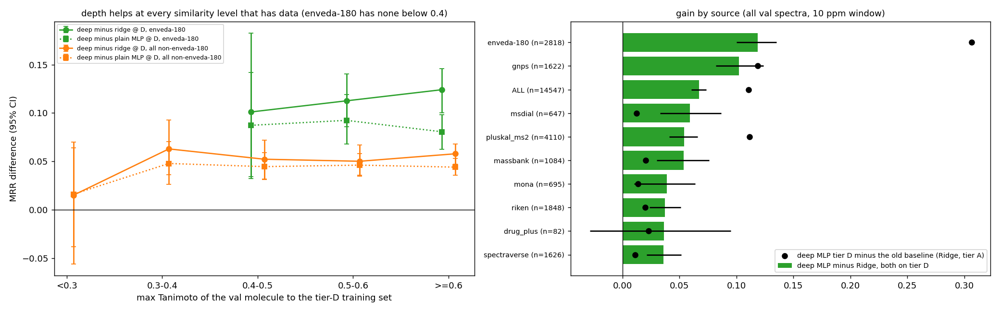
*Deep MLP at tier D: gain by similarity bin and by source.*

| Training tier | spectra | Ridge (enveda-180 / mixed) | MLP 1024×1024 | Deep residual |
|---|---|---|---|---|
| A (= everything before v0.3b) | 61,701 | 0.4084 / 0.5425 | 0.2832 / 0.4542 | 0.2973 / 0.4735 |
| B | 139,679 | 0.4842 / 0.5780 | 0.3903 / 0.5443 | — |
| D | 633,198 | 0.5701 / 0.5871 | 0.5951 / 0.6062 | **0.6706 / 0.6557** |

Tables: [`results/scale_scores.csv`](results/scale_scores.csv), [`scale_bootstrap.csv`](results/scale_bootstrap.csv), [`scale_novelty.csv`](results/scale_novelty.csv), [`scale_auc.csv`](results/scale_auc.csv).

### Candidate-pool cost (P7a) and pooling check
Adding 432k COCONUT structures as decoys (true molecule still in the pool) lowers the deep model's score by about 0.11–0.13 on natural-product-like validation sources (median candidates grow 2–5×), while `model − random` stays flat or rises: the cost is more same-mass isomers, not a worse model. Tables: [`results/p7a_pool_cost.csv`](results/p7a_pool_cost.csv), [`p7a_pool_cost_by_source.csv`](results/p7a_pool_cost_by_source.csv), [`pooling_check.csv`](results/pooling_check.csv).

### Candidate pool and ranking prior — the leaderboard levers (P7, v0.4)
**COCONUT (+0.052).** A train-only library cannot contain unseen molecules. Adding 432,150 COCONUT natural products (structures only, no spectra) raised the leaderboard from 0.076 to 0.128 even though a larger pool costs reachable molecules about 0.13 MRR (2–5× more same-mass isomers):

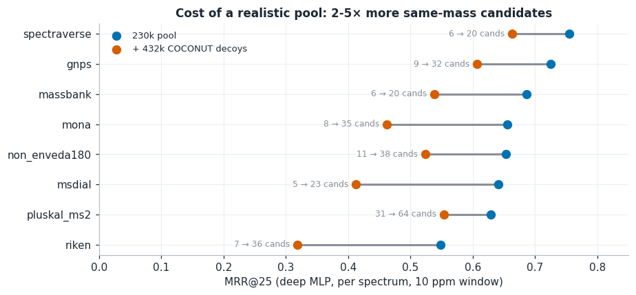

A rough decomposition (an estimate, not a measurement): of the 0.128, ≈0.063 comes from molecules also in the training set and ≈0.065 from COCONUT-only molecules, i.e. roughly 12–19% of hidden molecules.

**Popularity prior (+0.018).** Among same-mass candidates, the better-documented structure is more often the answer. Score = `z(cosine within the mass window) + w · pop` with the public PubChem popularity prior (`dmitriigluzdov/casmi26-pubchem-popularity-prior`): w = 0.15 → **0.146**, w = 0.30 → 0.140 (saturates, in line with that dataset's own warning).

**PubChem mass-window channel (built, benchmarked, neutral).** Because ~70% of hidden molecules are in neither the training set nor COCONUT, a channel adds every PubChem structure (105.9M, mass-sorted) inside each query's window, fingerprinted on the fly (tens to thousands per window):

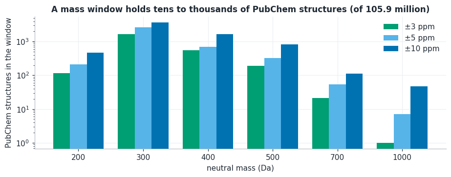

Merged naively, thousands of PubChem isomers out-score library candidates, so library candidates get a source bonus. On labelled validation molecules (A: truth in library, PubChem off; B: truth removed from the library, PubChem on; C: truth in library, PubChem on) a bonus of 2 keeps C within ≈0.05 of A while B retains 0.13–0.26:

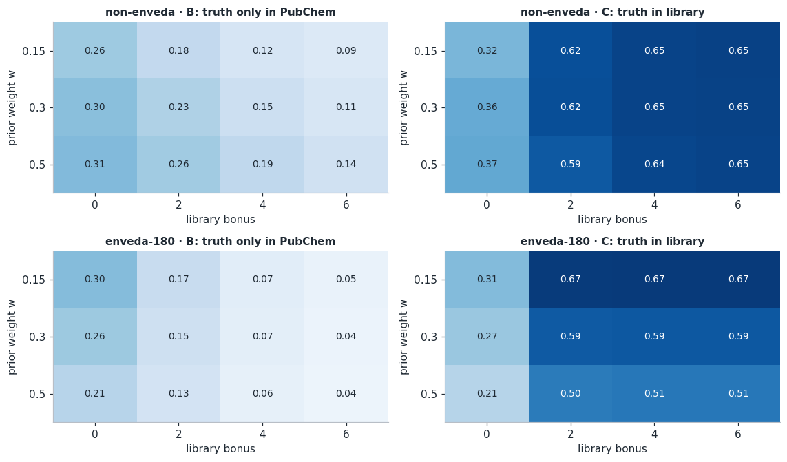

The benchmark predicted +0.01 to +0.05 for the submitted setting; the leaderboard moved **+0.002** (0.140 → 0.142 at the same weight):

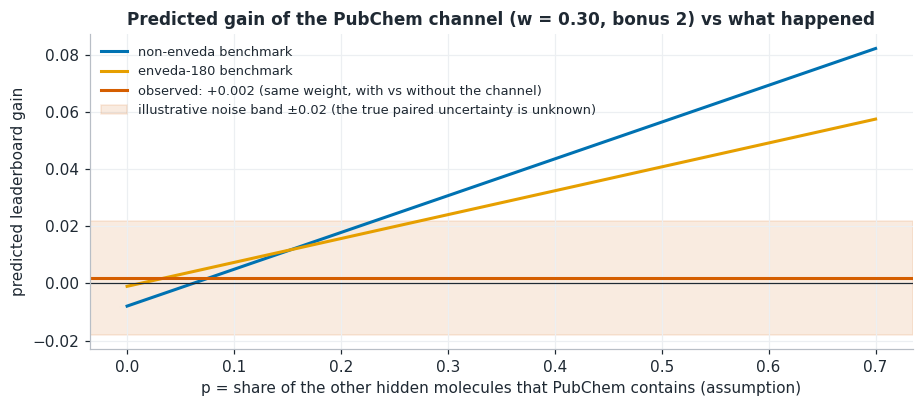

Three explanations fit and were not separated: the benchmark is optimistic (known, well-documented truths with analogues in training); fewer hidden molecules are in PubChem than assumed; the cosine ranker cannot place the answer among thousands of isomers. The channel is implemented (`USE_TIER` in `kaggle/casmi_infer.ipynb`) and switched **off**. Tables: [`results/p7d_tier_benchmark.csv`](results/p7d_tier_benchmark.csv).

**Tooling.** Training takes ~2 h on a Kaggle GPU, so the trained model, the training part of the library and the feature settings are *frozen* into a dataset and an inference-only notebook (`kaggle/casmi_infer.ipynb`, minutes, no GPU) runs the pool and ranking experiments. See [`kaggle/README.md`](kaggle/README.md).

### v0.3 — Replace the ranker with a public pretrained model (P10)
Full walkthrough with figures: [`notebooks/casmi_v0_3.ipynb`](notebooks/casmi_v0_3.ipynb). Log entries: [`docs/EXPERIMENT_LOG.md`](docs/EXPERIMENT_LOG.md) ("P10 ...").

**Probe: are the mass windows too tight? (no).** Every query keeps only library molecules in a window around the precursor-derived neutral mass, calibrated on training spectra of the lab behind the test data. Our benchmark can only measure inside the window, so a different calibration of the hidden batch would silently zero some molecules. Doubling every half-width (`WINDOW_SCALE = 2.0`) moved the score **0.146 → 0.148**, inside the noise: windows are not a lever (default stays ×1).

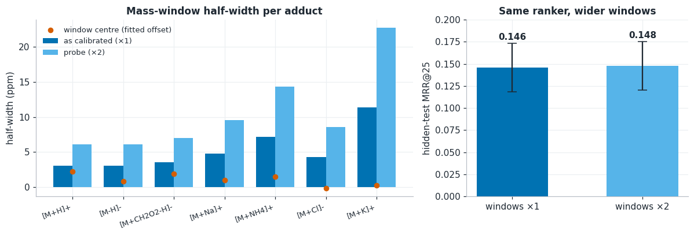

**FPNet as the ranker (+0.081).** The diagnosis of v0.2 was that the ranking model, not the pool, was the gap. [FPNet](https://www.kaggle.com/ahmedberatozer) (Ahmed Berat Özer) is a transformer over the peaks that outputs logits for 10,226 fingerprint bits (ECFP4/ECFP6/FCFP4, RDKit paths, atom pairs, torsions, MACCS) and is trained on the ranking task itself with hard negatives of the same mass; a candidate with fingerprint **f** scores **f · logits**. Candidate fingerprints are precomputed for the 710,701-structure public pool and joined to our library on the metric key (training keys 235,853 of 235,854, COCONUT 430,287 of 432,648). Only the scoring step changed (library 684,568, windows ×1, molecule-level pooling, prior 0.15 all as before): **0.146 → 0.229**.

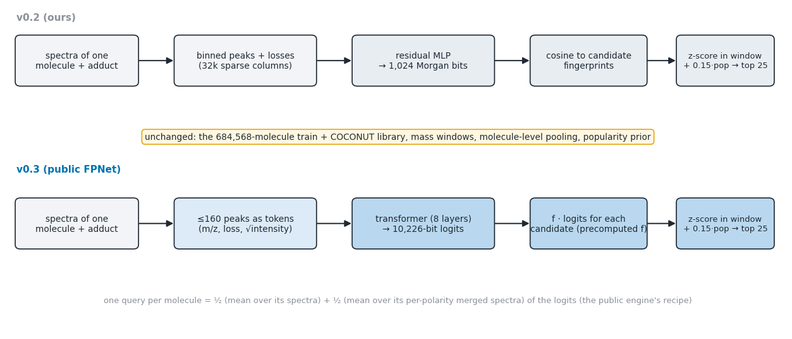

One query per molecule follows the public engine's recipe: the mean of the logits of its single spectra and the mean of the logits of its per-polarity merged spectra, averaged. Implementation: cell `fpnet_defs` of [`work/kaggle_cells.py`](work/kaggle_cells.py), switched by `USE_FPNET` / `FPNET_MODELS` / `FPNET_W_OURS` in the settings block of `kaggle/casmi_infer.ipynb`.

**Checks (wiring only).** There is no honest local score for FPNet. [`work/test_fpnet_plumbing.py`](work/test_fpnet_plumbing.py) recovers the true structure of the 400 visible-test molecules from their twins in the training file (the visible test is a sample of train) and ranks them with the notebook's own code: MRR@25 0.92–0.95, median window 54 candidates, no library row without a fingerprint. This is **leaked by construction** and only shows that queries, bit layout, key join and ranking are wired correctly.

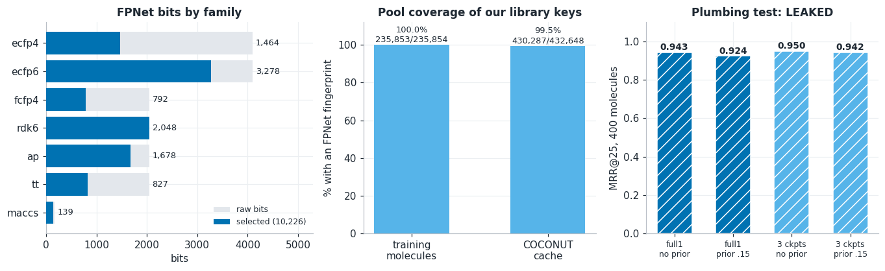

Tables: [`results/p10_leaderboard.csv`](results/p10_leaderboard.csv), [`p10_window_policy.csv`](results/p10_window_policy.csv), [`p10_fpnet_bit_blocks.csv`](results/p10_fpnet_bit_blocks.csv), [`p10_fpnet_pool_coverage.csv`](results/p10_fpnet_pool_coverage.csv), [`p10_fpnet_plumbing.csv`](results/p10_fpnet_plumbing.csv).

**Pending: three-checkpoint ensemble.** `FPNET_MODELS = "full1+AB"` averages the logits of `fpnet_full1` and the public `fpnet_0`, `fpnet_1` (same architecture and bit layout). Expectation written before the result: +0.00 to +0.03 (swapping one checkpoint for another changed the public notebooks' own score by only 0.002). The result was not available when this release was written.

---

## Limitations
- **Candidate pool.** Only an estimated ~25–33% of hidden molecules are reachable at all (≈12–14% in the training set, ≈12–19% COCONUT-only); the rest score 0 whatever the ranker does. These shares are inferred from leaderboard differences and assumed molecule-level MRRs, not measured.
- **Ranker.** v0.3 ranks with the public FPNet (0.229). Still missing relative to the public pipelines that reach 0.35–0.46: analog propagation from similar training spectra, fragmentation/sub-formula explanations of peaks, derivative generation, a trained LightGBM re-ranker, forward models (spectrum simulation for candidates). This is still the main gap.
- **FPNet cannot be validated locally.** `fpnet_full1` was trained on all training folds, i.e. on every molecule our validation uses; only the leaderboard (one score, standard error ≈ 0.014) measures it. The gain mixes FPNet's better fingerprint, its ranking-aware training and the interaction with the popularity weight (0.15, chosen when ranking with our MLP and not retuned). The three-checkpoint ensemble result is pending.
- **Public weights, non-commercial terms.** The FPNet checkpoint, code and pool carry the competition-data terms (non-commercial, attribution); none of them is redistributed here.
- **Score noise.** About 400 hidden molecules and an MRR of ~0.14 give a standard error of ≈0.014 per score. The prior weight (0.15 vs 0.30) and the PubChem channel (+0.002) are not distinguishable from noise.
- **Domain gap.** Local validation is dominated by lab-library chemistry. At tier D every enveda-180 validation molecule has a training neighbour at Tanimoto ≥ 0.4; for genuinely novel molecules (< 0.3) the deep model's gain is unconfirmed (n = 97, CI includes 0). The PubChem benchmark is similarly optimistic (known, well-documented truths), which is the most likely reason it over-predicted.
- **Mass-window calibration** (offsets and widths) was fitted on enveda-180 training spectra; doubling the windows changed the hidden-test score by +0.002 (noise), so the calibration transfers well enough. Features stop at m/z 1,000 (hidden masses reach ~1,159 Da).
- **The benchmark pool's decoys** are mostly training molecules at tier D (no leak of the validation truth, but unlike the test situation); the real library (684k) has more distractors than the 230k benchmark pool.
- **One seed per run**; CIs cover validation-query sampling, not training randomness. MLP hyper-parameters were tuned at tier A and early-stopped on BCE, not on ranking; training uses ≤ 3 spectra per molecule (633k of 1.73M cleaned spectra).
- **The visible `test.parquet` is a placeholder** drawn from training spectra (all 1,213 spectra have exact twins in train); Kaggle commit-run scores on it are meaningless, only the hidden-test rerun counts.
- v0.1 benchmark numbers are not exactly reproducible (unseeded evaluation sample); later versions are seeded.

## Repository layout
```
README.md
requirements.txt
notebooks/casmi_v0_3.ipynb                v0.3 REPORT notebook: windows probe, FPNet as the ranker, checks, limitations (executed, no data needed)
notebooks/casmi_v0_2.ipynb                v0.2 REPORT notebook: data exploration, method, all experiments up to 0.146 (executed, no data needed)
notebooks/enveda-casmi26-baseline.ipynb   v0.1 baseline + EDA/P3/P4/P5 cells (outputs kept for the v0.1 part)
reports/                                  figures (p2_* EDA, p3_* mass window, p4*/p5* models, v01_* baseline, v02_* pool and PubChem channel, v03_* windows probe and FPNet)
results/                                  per-experiment tables (scores, bootstrap CIs, novelty/source breakdowns, training histories, PubChem benchmark)
docs/EXPERIMENT_LOG.md                    one entry per version: hypothesis, single change, numbers, caveats, decision
src/                                      reusable modules: pipeline, benchmark, mass window, MLP, cache builders
work/                                     experiment scripts (p3_ … p7d_), Kaggle-notebook source and builder, FPNet wiring test (test_fpnet_plumbing.py), release-notebook builders
kaggle/                                   Kaggle notebooks: training (+freeze), Ridge baseline, inference-only (casmi_infer), run instructions
reference/v0_1_pipeline.py                condensed v0.1 code (reference only, not directly runnable)
```
The Kaggle notebooks are generated from `work/kaggle_cells.py`; edit that, then run `python work/build_kaggle_notebook.py`. The report notebooks are generated by `python work/release_eda.py && python work/build_release_notebook.py` (v0.2) and `python work/build_release_notebook_v03.py` (v0.3; embeds the tables `results/p10_*.csv`, which the 2026-10-22 session wrote into `artifacts/`).

## Reproducing
Data is not included. Download the competition files from the Kaggle page into `data/` (`train.parquet`, `test.parquet`, `sample_submission.csv`).

```bash
pip install -r requirements.txt            # RDKit must be 2026.3.3
python src/build_canon_cache.py            # once: canonical keys + scaffolds (~2 min on 8 cores)
python work/p3_benchmark.py                # v0.1b mass-window benchmark
python work/p4c_defect_bins.py             # v0.2c features + Ridge (needs ~10 GB RAM; run each large fit in its own process)
python work/p5b_build_data.py              # v0.3b: build tiers (~15 min)
python work/p5b_fit.py deep D              # deep residual MLP at tier D (~50 min on Apple MPS)
python work/p5b_score.py                   # score all tiers/models
python work/p7a_pool_cost.py               # cost of the larger (COCONUT) pool
python src/build_coconut_cache.py          # COCONUT keys/masses/fingerprints (needs the public COCONUT Kaggle dataset in data/external/coconut/)
python work/p7d_tier_benchmark.py          # PubChem-channel benchmark (needs the PubChem tier arrays, ~9 GB, in data/external/pubchem_tier/)
```
Notes: `src/v1_pipeline.py` still loads the v0.1 decoy files (`dec_keys.npy`, `dec_fp_n.npy`, `dec_mass.npy`) from the working directory; they are produced by the v0.1 notebook (they are not included here, 830 MB). The Ridge solver builds a ~6–8 GB Gram matrix and a 16 GB machine cannot run it alongside GPU training; scripts expect the layout above (`data/`, `artifacts/`). For the FPNet ranker (v0.3) additionally attach the public Kaggle datasets `ahmedberatozer/casmi26-fpnet-full1`, `ahmedberatozer/casmi26-v3-models` (code and the extra checkpoints) and `ahmedberatozer/casmi26-v2-pool` (candidate fingerprints, bit list) to `kaggle/casmi_infer.ipynb` and set `USE_FPNET = True`; locally `python work/test_fpnet_plumbing.py` runs the leaked wiring check after downloading them into `data/external/fpnet/` (layout in the script header and `kaggle/README.md`). To submit, follow [`kaggle/README.md`](kaggle/README.md): train once (or restore the cached features), freeze the model and the training part of the library, then run `kaggle/casmi_infer.ipynb` with its settings block (`POP_WEIGHT`, `USE_TIER`, `TIER_LIB_BONUS`, `WINDOW_SCALE`, `USE_FPNET`, `FPNET_MODELS`, `FPNET_W_OURS`). Internet is disabled in the competition notebooks, so COCONUT, the popularity prior and the frozen model are attached as Kaggle datasets.

## Data, rules and licences
- Competition data is not redistributed here. Figures and tables are derived from it; the competition data are reported to be CC BY-NC 4.0, so keep the project non-commercial and credit the sources.
- The COCONUT candidate cache is built from the Kaggle dataset `prvsiyan/coconut-casmi26-candidates` (CC BY-NC-SA 4.0); credit the author if you use it.
- The popularity prior and the PubChem tier come from `dmitriigluzdov/casmi26-pubchem-popularity-prior` (PubChem data, courtesy of the U.S. National Library of Medicine; LOTUS counts CC BY 4.0; NPAtlas CC BY-NC 4.0; see that dataset's README). Comparisons with public pipelines are quoted from the public notebook *CASMI 26: The Data Behind Spectra to Structures* and the notebooks credited there.
- **FPNet (v0.3):** architecture, fingerprint bit selection, candidate pool and checkpoints by Ahmed Berat Özer (`ahmedberatozer/casmi26-fpnet-full1`, `casmi26-v3-models`, `casmi26-v2-pool`); fold-safe training kit and audit by Dmitrii Gluzdov (`dmitriigluzdov/casmi26-fold-safe-fpnet`). They are public Kaggle datasets under the competition data terms (non-commercial, attribution). This repository contains only code that loads them; it does not redistribute weights, fingerprints or competition data.
- The frozen model and run-cache datasets contain competition-derived data and should stay private.
- **Check the competition rules on code sharing before making this repository public while the competition is running** (final submission 2026-12-14). Rules wording on external data and notebook requirements was confirmed (public external data and pretrained models are allowed; submissions only via offline Notebooks, ≤ 9 h), but the code-sharing clause has not been read from the Rules page by the author.
- No software licence has been chosen yet.

## Roadmap
1. **Read the pending three-checkpoint result**, then decide between more FPNet variants (fold-safe checkpoints; a small blend with our MLP) and the bigger step below.
2. **Close the rest of the ranker gap (0.229 vs 0.35–0.46):** feasibility study of running the public engine (analog propagation, fragmentation and sub-formula channels, trained LightGBM ranker, optional derivative generation): inputs, runtime, licence; then build it as one change in `kaggle/casmi_infer.ipynb`.
3. Similarity-controlled validation (held-out molecule clusters at Tanimoto < 0.4) and the fold-safe FPNet checkpoints as a way to measure behaviour on unseen molecules before trusting absolute numbers.
4. Re-tune the deep MLP at scale (MRR-aligned early stopping, multiple seeds, all 1.73M spectra) only if our MLP stays in the final blend.
5. Revisit the PubChem channel only with a stronger ranker (it was neutral with fingerprint cosine).
